# ICU-EWS — Intelligent ICU Early Warning System

**A research prototype for ICU deterioration early warning, explainability and cohort analytics.**

> **Research prototype — not a medical device.** ICU-EWS is a demonstration and research project. It has not been
> prospectively validated, has not been reviewed by a regulatory body, and must not be used to guide patient care.
> All data shipped with this repository is synthetic. No real patient data, hospital identifiers or protected health
> information is included.

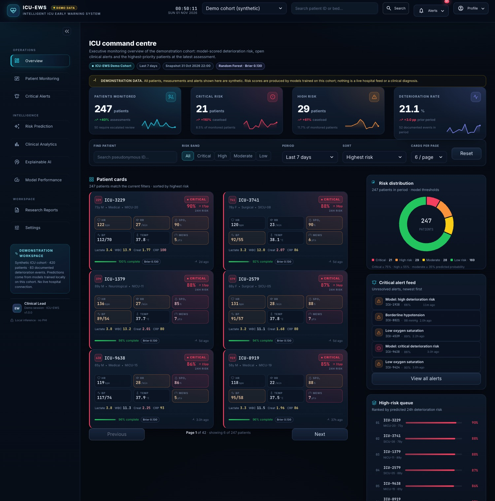

## Overview

ICU-EWS is an end-to-end data science platform that predicts the probability of a documented clinical
deterioration event within the next 24 hours for ICU patients, and communicates that risk through a Streamlit
command-centre designed for research review. It combines:

- a reproducible **synthetic ICU cohort generator** (patients, hourly observations, laboratory panels, documented outcomes),
- a **feature engineering pipeline** (47 model inputs covering physiology, trends, acuity events, laboratory values and data quality),
- **multiple trained classifiers** (XGBoost, Random Forest, Logistic Regression) with cross-validated model selection and a held-out test partition,
- **SHAP-based explainability** at global and individual-patient level,
- **derived clinical alerts** based on recorded vital-sign and laboratory rules plus model risk,
- **cohort analytics, reports and exports** computed from the active model artifact,
- a **nine-workspace dashboard** with patient search, filters, risk trajectories, interactive charts and downloadable reports.

Every metric displayed by the application is computed from the trained artifacts at runtime. Nothing is presented
as hospital data, and no live clinical integration exists.

## Problem statement

Deterioration in critically ill patients can be preceded by subtle, multivariate changes in vital signs and
laboratory values that are difficult to track manually across a busy ICU. Early warning scores and machine-learning
models can surface those patterns, but clinical trust requires more than a risk number: reviewers need to see the
model's evaluation, understand which features drive a prediction, and inspect the cohort the model was trained on.

ICU-EWS addresses the analytical workflow around that problem in a transparent research setting:

1. generate a reproducible cohort with known outcome definitions,
2. engineer clinically interpretable features from longitudinal observations,
3. train and compare candidate models without test-set leakage,
4. evaluate discrimination, calibration and threshold behaviour on held-out data,
5. explain model output with SHAP, and
6. present the results in an auditable dashboard with exports.

## Research objectives

- Build a reproducible, privacy-safe ICU demonstration cohort for early-warning research.
- Compare tree-ensemble and linear baselines for 24-hour deterioration prediction.
- Select the operating threshold from out-of-fold predictions rather than the test set.
- Evaluate discrimination (ROC-AUC, PR-AUC), calibration (Brier score) and operating-point performance (sensitivity, specificity, F1) on held-out data.
- Provide patient-level and global SHAP explanations that are computed from the trained model.
- Expose every cohort statistic, alert and report as a recomputable output of the active artifact and session thresholds.

## Data Science workflow

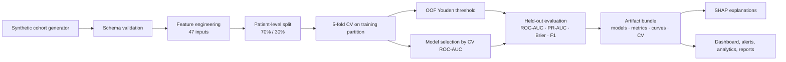

The split is made at the patient level: all observations for a patient stay on one side of the split, and the
held-out test partition is never used for threshold selection or model selection.

## Dataset information

The repository ships one artifact bundle at `artifacts/bundles/demo-cohort-v1/`, generated deterministically from
seed `7` by `icu_ews/data/demo.py` (`demo-cohort/1.2`).

| Property | Value |
|---|---|
| Patients | 420 |
| Hourly observation rows | 14,901 |
| Laboratory panels | 1,527 |
| Documented 24h deterioration events | 83 (19.8%) |
| Model inputs | 47 |
| Training / held-out patients | 294 / 126 |
| Target | Documented deterioration event within 24h of the assessment window |
| Split seed | 42 |
| Cross-validation | 5-fold, training partition only |

The generator models admission type, diagnosis group, comorbidity burden, length of stay, longitudinal vital
signs with within-patient correlation, intermittent laboratory sampling and a latent severity process that drives
the documented outcome. Generated identifiers are pseudonymous (`ICU-####`) and contain no real information.

**This cohort is synthetic.** Its statistics describe the demonstration dataset only and carry no external
validity. Raw clinical datasets are deliberately excluded from this repository (`data/raw/` is git-ignored).

## Data preprocessing

- Timestamps are parsed and each patient's assessment anchor is defined as the last observed hour in the bundle.
- Laboratory panels are merged to the latest value available at or before the anchor (no future leakage).
- The 8-hour window before the anchor is used for means, minima, maxima and linear slopes.
- AVPU consciousness levels are mapped to an ordinal score; MEWS is derived from the recorded vitals.
- Categorical admission type is one-hot encoded into four indicator columns.
- Missing values are handled inside the scikit-learn preprocessing pipeline that is fitted on the training partition only.
- Data completeness is computed as the fraction of expected observations present in the assessment window.

## Feature engineering

47 inputs are grouped into five families (full definitions in [docs/data_dictionary.md](docs/data_dictionary.md)):

| Group | Examples |
|---|---|
| Patient | Age, sex, comorbidity count, admission type indicators, assessment hour |
| Vital signs | Latest HR, RR, SpO₂, systolic/diastolic BP, MAP, temperature, MEWS, shock index, worst AVPU |
| Trends (8h) | Means, minima, maxima and linear slopes for HR, RR, SpO₂, systolic BP and temperature |
| Acuity events (8h) | Counts of SpO₂ < 92%, HR > 120 and systolic BP < 100 episodes |
| Laboratory | Lactate, WBC, creatinine, platelets, haemoglobin, CRP, bilirubin, sodium, potassium |
| Data quality | Hours since last labs, observations in the 8h window, data completeness |

Feature definitions and units are also exposed in-app and in the downloadable data dictionary.

## Machine Learning algorithms

Three candidate models share the same preprocessing pipeline:

- **Random Forest** — selected as the primary model by the highest mean 5-fold cross-validated ROC-AUC on the training partition.
- **XGBoost** — gradient-boosted trees with class-imbalance weighting and a small hyperparameter search.
- **Logistic Regression** — regularised linear baseline with a standardised input pipeline.

The primary-model threshold is chosen from out-of-fold predictions with the Youden J statistic. The same
threshold is then applied unchanged to the held-out test partition.

## Model evaluation

Held-out test partition: 126 patients, 25 documented events (19.8%). All values below are computed by the training
pipeline and stored in the artifact bundle; the application recomputes the operating-point metrics from the saved
probabilities at runtime.

| Model | Threshold | ROC-AUC | PR-AUC | Sensitivity | Specificity | F1 | Brier | CV ROC-AUC |
|---|---:|---:|---:|---:|---:|---:|---:|---:|
| **Random Forest (primary)** | 0.332 | **0.847** | **0.516** | 76.0% | 76.2% | 0.559 | **0.130** | 0.809 ± 0.030 |
| XGBoost | 0.128 | 0.765 | 0.427 | 72.0% | 75.3% | 0.529 | 0.170 | 0.802 ± 0.033 |
| Logistic Regression | 0.407 | 0.795 | 0.469 | 76.0% | 66.3% | 0.487 | 0.197 | 0.764 ± 0.052 |

Random Forest confusion matrix at its operating threshold: TP 19, FP 24, FN 6, TN 77.

These are single-cohort, synthetic-data results. They demonstrate that the pipeline is wired end-to-end; they are
**not evidence of clinical effectiveness**. Re-run `scripts/bootstrap_demo.py` to reproduce the workflow with a
different seed or cohort size.

Beyond the headline metrics, the dashboard shows ROC and precision–recall curves, the confusion matrix, calibration
curves, cross-validation stability and a threshold trade-off table.

## SHAP explainability

Explanations are computed with `shap.TreeExplainer` on the primary model and the 126 held-out assessments:

- **Global importance** — mean absolute SHAP value per feature.
- **Beeswarm** — per-assessment contribution distribution, coloured by feature value.
- **Dependence** — SHAP contribution versus feature value for a selected input.
- **Individual explanation** — additive waterfall for one patient assessment, with increasing and decreasing features.

The application reports the SHAP base value and link space, and labels every chart as model attribution rather than
clinical causality. No SHAP values are hard-coded.

## Dashboard features

The interface runs as a single Streamlit application with session-state routing and deep links (`?view=...&pid=...`).

| Workspace | What it does |
|---|---|
| **Overview** | KPI cards, searchable/filterable patient cards, risk distribution, critical alert feed, high-risk queue, prediction activity, measurement alerts |
| **Patient Monitoring** | Cohort-wide bedside card grid with risk, unit, search, sort, window and pagination controls |
| **Patient Detail** | Header with risk/context, vital-sign trends by metric and window, risk trajectory, laboratory trends, blood pressure, assessment context, patient alerts, SHAP breakdown |
| **Critical Alerts** | Rule-derived and model-derived alerts with category, status, search, time window, acknowledge, resolve, reopen, export and patient navigation |
| **Risk Prediction** | Interactive scenario scoring from the trained model, monitored-patient or manual mode, gauge, SHAP explanation, CSV export |
| **Clinical Analytics** | Admission/deterioration trend, demographics, length of stay, vital and laboratory distributions, physiology scatter, Spearman correlation heatmap, outcome distribution, subgroup comparisons and statistics |
| **Explainable AI** | Global importance, beeswarm, dependence and individual waterfall computed from the artifact |
| **Model Performance** | Model comparison, ROC/PR curves, confusion matrix, calibration, cross-validation stability, threshold trade-off and evaluation methodology |
| **Research Reports** | Cohort snapshot, metrics, feature attributions, alert log, data dictionary, Markdown narrative and a ZIP bundle |

All visible controls are functional: filters recompute every dependent chart, cards and alert items are clickable,
and reports are generated from the active artifact and session thresholds. The UI is explicitly labelled as a
demonstration workspace, and alerts are local research alerts only — nothing is transmitted to any clinical system.

## Project architecture

```text
ICU-EWS/
├── app.py                      # Streamlit entry point
├── icu_ews/
│   ├── config.py               # App constants, design tokens, thresholds
│   ├── state.py                # Session state, routing, view helpers
│   ├── shell.py                # Fixed top navigation and sidebar
│   ├── theme.py                # Global CSS design system
│   ├── icons.py                # Inline SVG icon set
│   ├── analytics.py            # Cohort-level statistics helpers
│   ├── data/
│   │   ├── demo.py             # Synthetic cohort generator
│   │   ├── schema.py           # Dataset contracts and validation
│   │   ├── mews.py             # MEWS derivation
│   │   ├── alerts.py           # Alert rules and workflow state
│   │   └── repository.py       # Cached data access for the UI
│   ├── ml/
│   │   ├── features.py         # Feature engineering and labels
│   │   ├── training.py         # CV, metrics, calibration, model selection
│   │   ├── explain.py          # SHAP computation and patient explanations
│   │   └── artifacts.py        # Bundle persistence and loading
│   ├── ui/
│   │   ├── components.py       # Reusable HTML/Streamlit components
│   │   └── charts.py           # Plotly theme and chart builders
│   └── views/                  # One module per workspace
├── artifacts/bundles/demo-cohort-v1/
│   ├── bundle.joblib           # Trained models + evaluation artifacts
│   ├── bundle.json             # Metrics, CV, thresholds, training metadata
│   ├── meta.json               # Cohort metadata
│   └── *.parquet               # Synthetic patients, observations, labs
├── scripts/
│   ├── bootstrap_demo.py       # Regenerate cohort + retrain models
│   ├── tune_xgb.py             # Optional XGBoost hyperparameter search
│   ├── shoot.py                # Playwright visual QA helper
│   └── probe_dom.py            # Playwright DOM probe helper
├── tests/                      # Pytest suite
├── docs/                       # Model card, data dictionary, architecture, deployment
├── requirements.txt
└── requirements-dev.txt
```

The UI layer never trains models and never computes SHAP on its own; it reads the persisted bundle through cached
repository functions. Expensive operations (dataset loading, snapshot construction, SHAP, alert building) are cached
per dataset and threshold set.

## Technology stack

| Layer | Tools |
|---|---|
| Application | Streamlit 1.51+, Python 3.11+ |
| Visualisation | Plotly 6, custom CSS design system |
| Data | Pandas 2.2+, NumPy 2, PyArrow / Parquet |
| Modelling | scikit-learn 1.5+, XGBoost 2.1+ |
| Explainability | SHAP 0.46+ |
| Persistence | joblib bundles, JSON metadata |
| QA | pytest, Playwright (development only) |

## Installation

```bash
git clone https://github.com/angadimohit6-svg/ICU-EWS.git
cd ICU-EWS

python3 -m venv .venv
source .venv/bin/activate          # Windows: .venv\Scripts\activate
pip install -r requirements.txt
```

The trained artifact bundle is committed, so the dashboard runs without retraining. A Python 3.11+ interpreter is
recommended.

## Execution

```bash
streamlit run app.py
```

The app opens at `http://localhost:8501`. Use the sidebar to move between workspaces, or deep-link directly:

```text
http://localhost:8501/?view=monitoring
http://localhost:8501/?view=patient&pid=ICU-4808
```

### Rebuild the demonstration bundle

```bash
python scripts/bootstrap_demo.py --seed 7 --patients 420 --slug demo-cohort-v1
```

This regenerates the synthetic cohort, validates the schema, trains all three models, computes cross-validation and
held-out metrics, fits SHAP-ready artifacts and writes a new bundle to `artifacts/bundles/`. Expected runtime is
roughly one minute on a laptop CPU.

### Tests

```bash
pip install -r requirements-dev.txt
python -m pytest -q
```

The suite checks cohort determinism and schema validity, feature construction, threshold mapping, alert derivation,
bundle integrity (stored metrics are recomputed from saved probabilities), SHAP additivity and workflow-state
persistence.

## Model artifacts

| File | Size | Contents |
|---|---|---|
| `artifacts/bundles/demo-cohort-v1/bundle.joblib` | ~539 KB | Fitted preprocessing and model pipelines, feature names, train/test matrices, saved probabilities, calibration and importance data |
| `artifacts/bundles/demo-cohort-v1/bundle.json` | ~4 KB | Held-out metrics, cross-validation folds, thresholds and training metadata |
| `artifacts/bundles/demo-cohort-v1/meta.json` | ~1.5 KB | Cohort provenance and counts |
| `artifacts/bundles/demo-cohort-v1/*.parquet` | ~153 KB | Synthetic patients, observations and laboratory panels |

The joblib bundle contains models trained **only** on synthetic data generated in this repository. It contains no
real patient records. No Git LFS configuration is needed: every file is well below GitHub's size limits.

## Screenshots

| | |
|---|---|
| 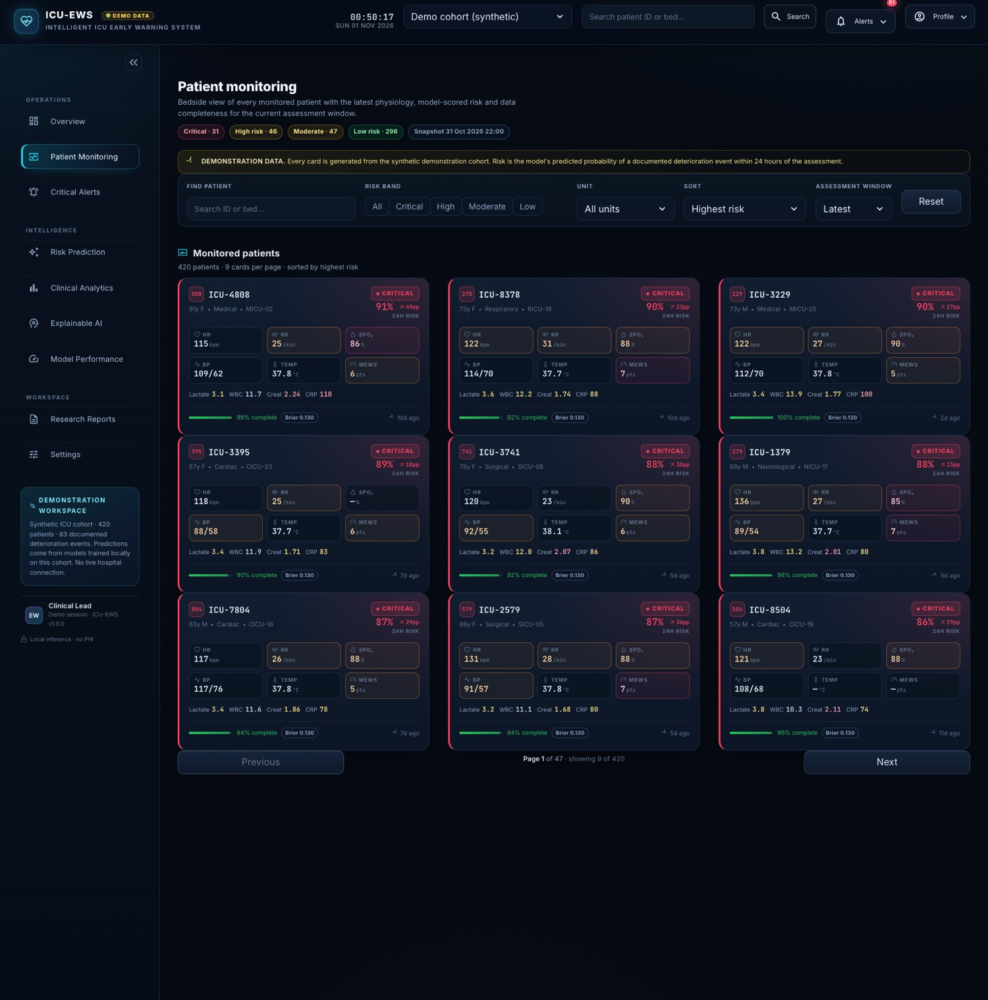 | 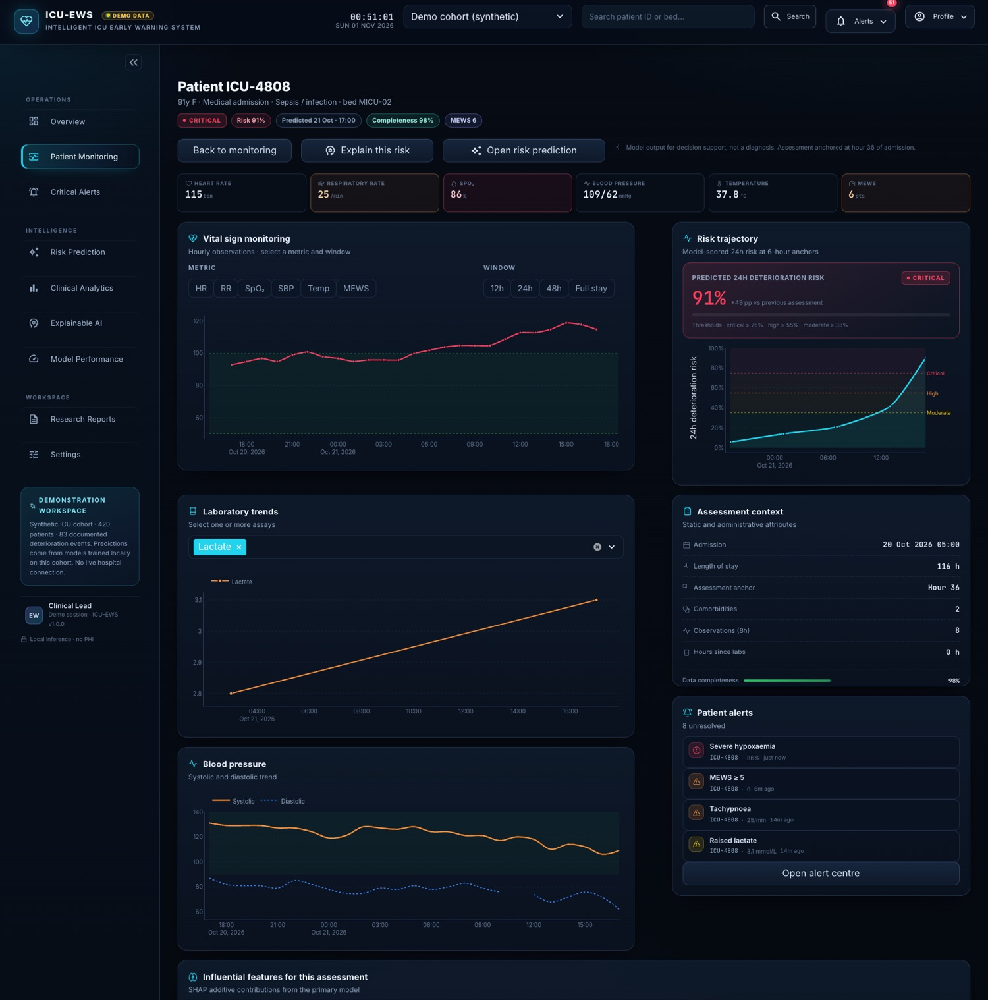 |
| Cohort-wide monitoring and risk cards | Patient detail with trends, risk trajectory and SHAP |
| 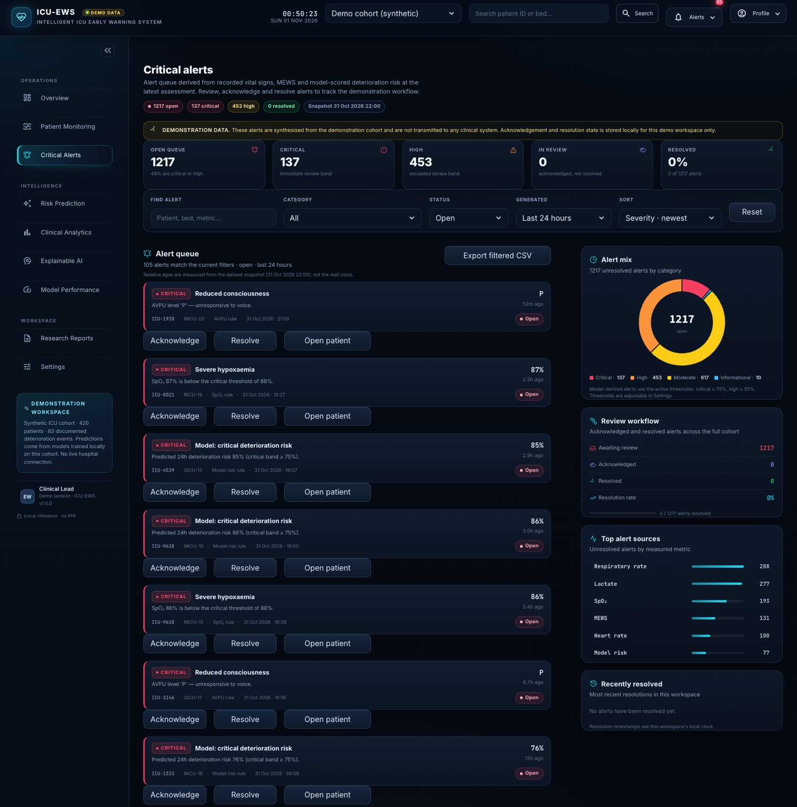 | 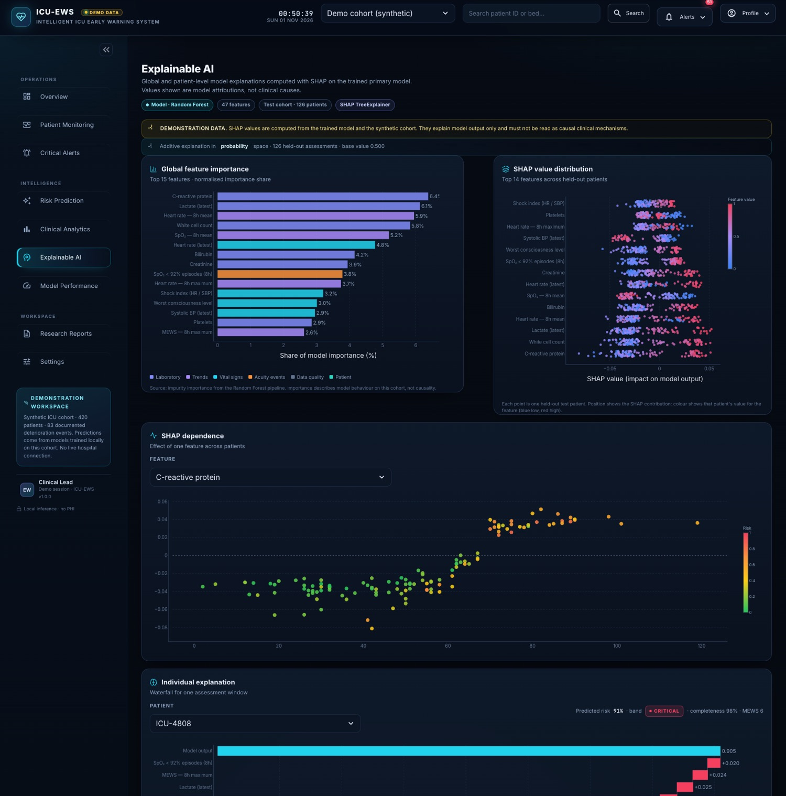 |
| Alert workflow with acknowledgement and resolution | Global and individual SHAP explanations |
| 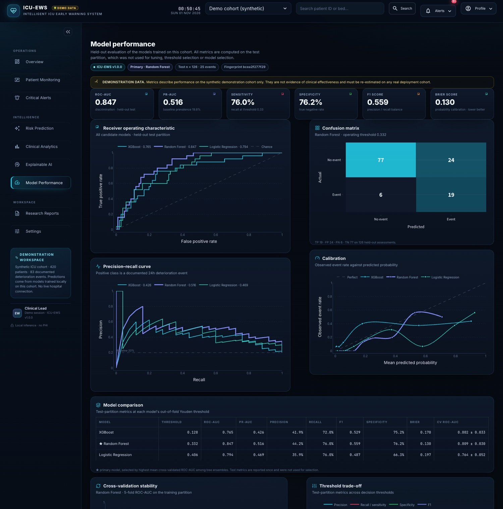 | 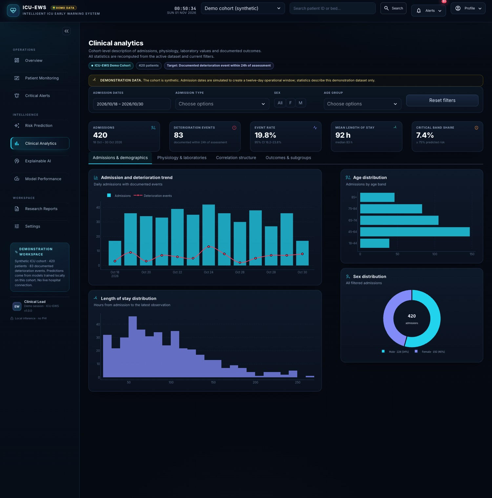 |
| Held-out evaluation and calibration | Cohort analytics with interactive filters |
| 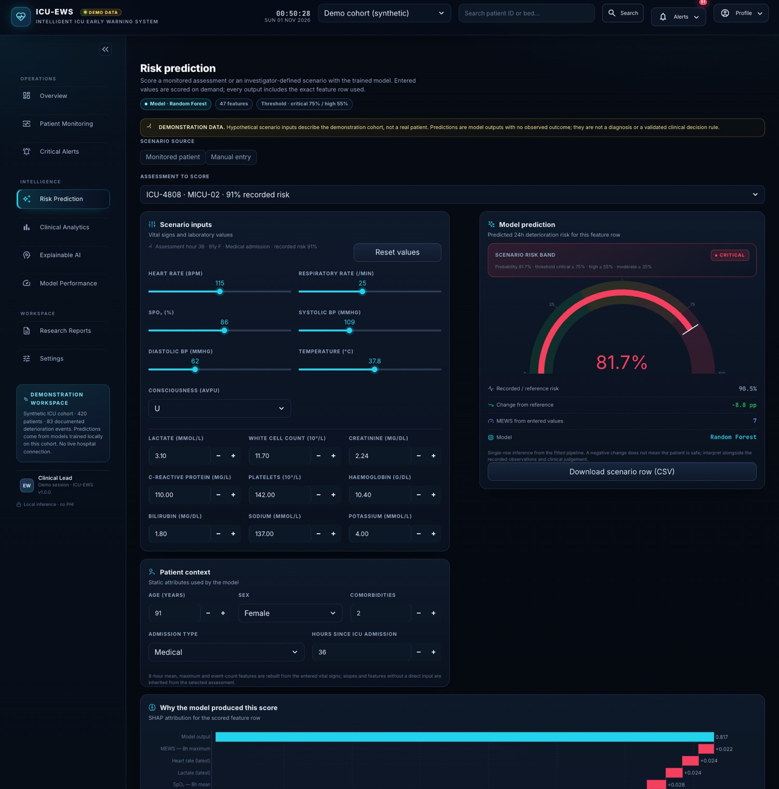 | 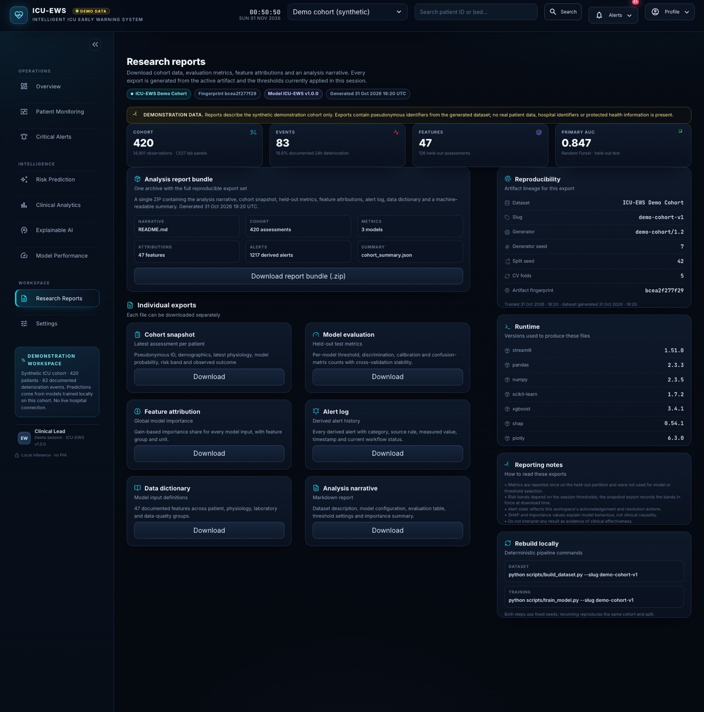 |
| Interactive scenario scoring with SHAP | Report exports and reproducibility metadata |
| 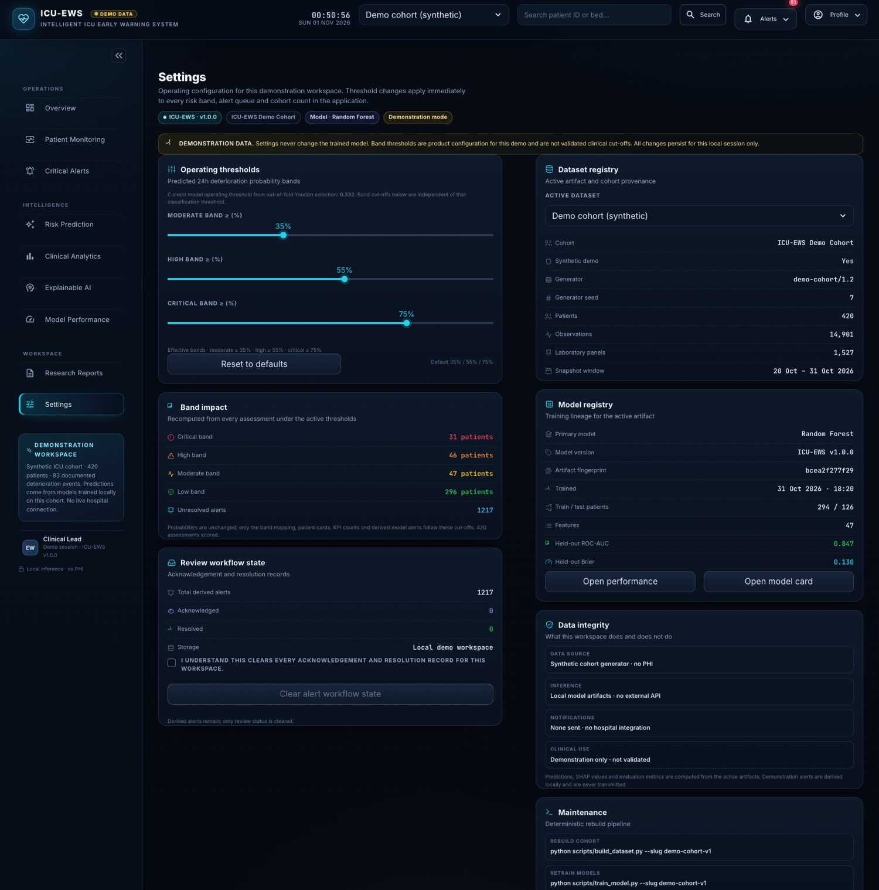 | 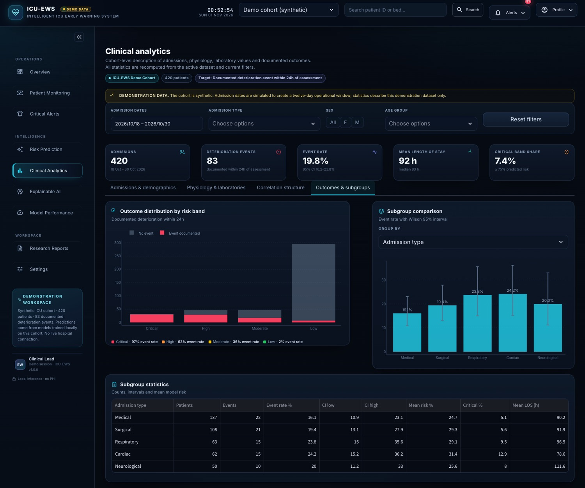 |
| Session thresholds, dataset registry and workflow state | Outcome distribution and subgroup comparison |

## Model limitations

- **Synthetic training data.** The cohort is generated by a parametric simulator, so relationships between features and outcomes reflect the simulator's assumptions, not observed clinical epidemiology.
- **Small evaluation sample.** The held-out partition contains 126 patients and 25 events; confidence intervals around every metric are wide.
- **No external validation.** Performance has not been tested on MIMIC-IV, eICU, hospital data or any prospective cohort.
- **Single time horizon.** The target is documented deterioration within 24 hours at a fixed assessment anchor; earlier or later horizons are not evaluated.
- **No causal claims.** SHAP values describe model behaviour, not physiological causation.
- **Calibration on synthetic outcomes.** Brier scores and calibration curves describe this cohort only; recalibration would be required for any new population.
- **Threshold sensitivity.** Band assignments are session parameters, not validated clinical cut-offs.
- **No missing-data stress test beyond the generator's gaps.** Real-world charting artefacts are not simulated exhaustively.
- **Interface, not workflow validation.** The acknowledgement/resolution workflow is local research tooling and has not been evaluated with clinical users.

## Ethical considerations

- **No PHI.** All identifiers, admissions, physiology and outcomes are synthetic. `data/raw/` is ignored to prevent accidental inclusion of restricted datasets.
- **No clinical deployment.** The application never transmits alerts, never integrates with EHR or paging systems, and states this in the interface.
- **No misleading labels.** Every page carries a demonstration-data banner; risk scores are labelled as model outputs, not diagnoses.
- **Transparency.** Metrics, thresholds and SHAP values are computed from committed artifacts and are reproducible with the scripts in this repository.
- **Model risk awareness.** A false negative in a real deployment could delay escalation; a false positive could cause alarm fatigue. Neither is acceptable without prospective evaluation, governance and clinician oversight.
- **Dataset agreements.** If you adapt this pipeline to MIMIC-IV or another credentialed dataset, follow that dataset's data-use agreement. Do not commit restricted data or models whose distribution is not authorized.

## Future scope

- External validation on credentialed ICU datasets (MIMIC-IV, eICU) with dataset-specific feature mapping.
- Temporal validation and prospective silent-mode evaluation under ethics approval.
- Additional horizons (6h, 12h, 48h) and competing-risk framing.
- Survival and time-to-event modelling of deterioration.
- Fairness and subgroup auditing across age, sex and admission type with confidence intervals.
- Calibration drift monitoring and scheduled recalibration.
- Clinician-in-the-loop evaluation of alert burden and workflow fit.
- Optional containerised deployment with an audited inference boundary.

## Documentation

- [Architecture](docs/architecture.md)
- [Model card](docs/model_card.md)
- [Data dictionary](docs/data_dictionary.md)
- [Deployment notes](docs/deployment.md)

## Data integrity statement

Every KPI, alert, chart and report is computed from the artifact bundle and the thresholds currently applied in
the session. The repository contains no hard-coded evaluation metrics, no fabricated patient predictions and no
fabricated SHAP values. Demonstration alerts are derived locally from synthetic records and are not transmitted to
any clinical system.

---

**ICU-EWS is a research prototype and not a clinically validated medical device.**
